# 검증 결과 영수증 PoC

2026 모바일신분증 아이디어 공모전 제출용 개념 검증(PoC)입니다.
**가상 데이터·데모용**이며 실제 행안부 시스템과 연결되어 있지 않습니다.

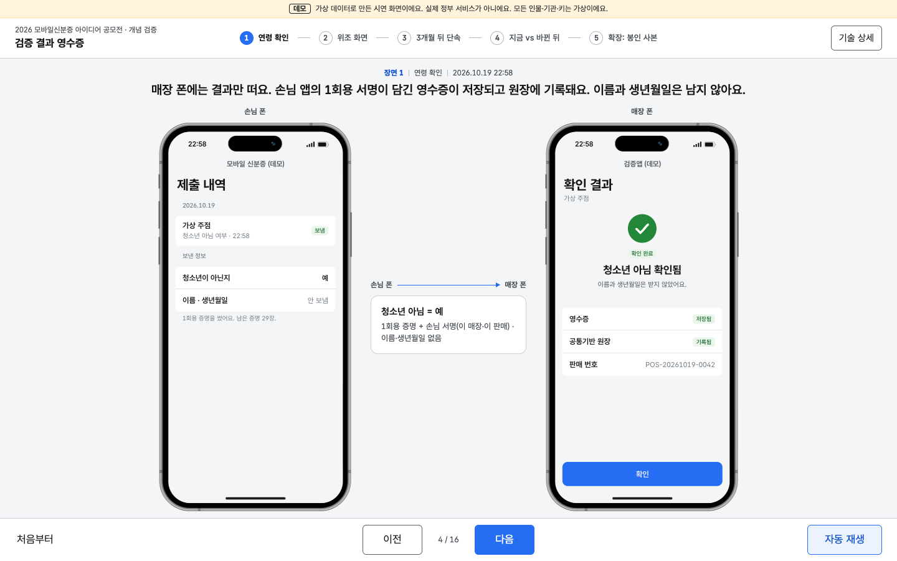

## 목적

매장·기관은 신분증 화면이나 사진을 보는 대신, **발급기관이 판정해 서명한 결과**(청소년 보호법상 청소년 아님, 연 나이 기준 Y/N)만 받습니다.
판매 한 건마다 **영수증 v2**가 남습니다. 영수증에는 손님 지갑이 이 매장·이 판매에 맞춰 서명한 1회용 증명이 들어 있어서 **업주가 매장 키만으로는 만들 수 없고**, 개인정보는 없습니다.

### 영수증 v2 구조

```
[발급기관] ──서명──> 연령 전용 1회용 증명 (SD-JWT 형식, vct=urn:kr:mid:age)
     _sd=[H(not_youth)], cnf=이 증명에만 쓰는 홀더 공개키, iat=발급 주의 월요일 0시(KST), exp=그로부터 5주 (false이면 다음 1월 1일 0시까지) — 둘 다 그 주 발급자 전원에게 같은 값
[손님 지갑] ──1회용 홀더 키로 서명──> KB-JWT
     { aud=매장 ID, nonce=매장 요청 nonce, iat=손님 폰 시각, sd_hash,
       transaction_data_hashes=[H(td)] }            ← OpenID4VP 1.0 부록 B.3.3.1의 방식
     td = { type:"kr.mid.age_check.sale", store, purpose:"LIQUOR", pos_tx_hash, req_at }
[검증앱(매장 키)] ──서명──> 영수증 v2 JWS  typ=vreceipt+jwt;v=2, 헤더 scert=등록기관이 서명한 매장 인증서
     { ver:2, rid, result, claim:"not_youth", purpose, store, iat, exp(90일), nonce, td, vp(위 증명+KB-JWT 원문) }
[가상 공통기반 원장] ──서명──> 원장 확인 { rh=H(영수증), sp=매장 가명, t }   원장에는 (rh, ph=H(발급기관 서명값), sp, t, result)만 기록
```

- `pos_tx_hash = SHA-256(거래번호 | 매장 비밀 salt)`. QR에는 해시만 들어가고, 단속 때 업주가 거래번호와 salt를 내면 구청이 대조합니다.
- 영수증에 남는 공개 항목은 `not_youth` 하나입니다. 이름·생년월일·출생연도는 연령 증명에 처음부터 들어가지 않습니다.
- 손님 지갑은 연령 증명을 **묶음(30장)으로 발급**받아 한 장을 한 번만 씁니다(RFC 9901 §10.1의 일괄 발급). 증명마다 홀더 키·salt·서명이 다르고, 발급 시각(iat)은 발급 주의 월요일 0시(KST), 만료(exp)는 그로부터 5주 뒤로 **그 주에 발급받은 모든 이용자에게 같은 값**입니다. 그래서 같은 날 발급된 두 증명도 홀더 키·salt·iat·exp 어느 것으로도 연결되지 않고, 익명 집합은 '그 주에 같은 결과(Y/N)로 발급받은 사람 전체'입니다(T12). 다만 발급기관이 영수증 원문을 받으면 연결할 수 있는 구조적 한계가 있어, 원장은 영수증 해시만 받습니다.

### 구청 재검증 15단계 (`verifyReceiptV2`, 서버 조회 없음)

앞 단계에서 실패하면 멈춥니다. 공개키(발급기관·등록기관·공통기반)와 업주가 낸 거래번호만 있으면 오프라인으로 검사합니다.

| # | 검사 | 막는 공격 (테스트) |
|---|---|---|
| R1 | 형식·허용 필드·필수 필드(`vp`·`td`·`nonce`) | 손님 제시물 없이 매장 키로만 만든 영수증 (T2), 개인정보 필드 혼입 |
| R2 | 매장 인증서: 등록기관 서명, 영수증 시각에 유효, 공개 폐기 목록(내려받은 것)의 폐기 시각 이후 발급이면 실패 | 미등록·폐기된 매장 키 (T11) |
| R3 | 매장 서명 | 재서명 없는 필드 변조 |
| R4 | 담긴 증명의 발급기관 서명(신뢰 목록, kid로 선택) | **업주 자가 발급**: 가짜 발급기관·가짜 손님 키 (T3) |
| R5 | 증명 유효기간을 손님 서명 시각 기준으로 판정 | 만료 증명 사용. 증명이 30일 뒤 만료돼도 85일 뒤 단속은 통과 (T1) |
| R6 | 공개 항목이 `_sd`에 있고 `not_youth` 하나뿐 | 생년월일 등 혼입 (T14), 값 변조 |
| R7 | 손님 서명: `cnf` 키로 KB-JWT 서명, `sd_hash` 일치 | 탈취 증명 재서명 |
| R8 | `kb.aud == 영수증 store == 인증서 sub` | 다른 매장 제시물 끼워 넣기 (T7) |
| R9 | `kb.nonce == 영수증 nonce` | 다른 요청의 nonce로 고쳐 재서명 (T16) |
| R10 | `H(td) ∈ kb.transaction_data_hashes`, td의 매장·목적, `pos_tx_hash == H(거래번호 \| salt)` | **바꿔치기**: 다른 판매의 성인 영수증 (T5) |
| R11 | `|영수증 iat − kb.iat| ≤ 300초` | **시각 조작**: 3시간 앞당겨 재서명 (T9) |
| R12 | 원장 확인: 공통기반 서명, `rh == H(영수증)`, 매장 가명(인증서 `pid`) 일치, 발급 뒤 24시간 안 | 사후 일괄 생성 (T10). 원장 확인이 없으면 실패가 아니라 「미확인」 경고 |
| R13 | `영수증 result == (not_youth ? Y : N)` | **N→Y 재서명** (T4) |
| R14 | 공통기반 원장의 증명 해시(`ph` = 발급기관 서명값의 해시) 대조: 같은 증명이 먼저 기록된 다른 영수증이 있으면 실패(매장 간). 같은 매장 영수증 묶음도 대조 | 같은 성인 증명 돌려쓰기 (T6 같은 매장, **T17 매장 A에서 쓴 증명을 매장 B에서 재사용**. 지갑은 재사용 자체를 거부) |
| R15 | 보관 기한(90일) | 기한 지난 영수증 |

검증 시점(매장 검증앱)에는 다른 매장 요청의 nonce로 만든 제시물이 nonce 검사에서 거부되고 영수증이 만들어지지 않습니다(T8).

업주 공격 생성기(`lib/tamper.js`)는 업주가 **매장 키를 갖고 있고 원장에도 올릴 수 있다**고 가정합니다. 그래도 손님 지갑 키와 발급기관 키는 없으므로 위 검사에서 거부됩니다. 막지 못하는 것: 성인의 휴대폰을 빌려 본인 인증까지 하는 경우(폰 대여). CCTV를 대체하지 않고 보완합니다.

### 연 나이: `not_youth`

- 청소년 보호법 제2조 제1호("19세가 되는 해의 1월 1일을 맞이한 사람은 제외")에 따라 `한국 시각 올해 − 출생연도 ≥ 19`이면 `true`. 생일은 보지 않습니다(`lib/age.js`).
- 발급기관이 판정해 서명하고, 매장 검증앱은 판정하지 않습니다. 생년월일·출생연도·만 나이는 공개하지 않습니다.
- `false` 증명은 **다음 해 1월 1일 0시(KST)에 만료**되어, 해가 바뀌면 지갑이 새 묶음을 받습니다. 지난해의 `false`로 만든 영수증은 그 시각 기준으로 계속 재검증됩니다.

## 화면: 두 대의 폰과 다섯 장면

왼쪽은 **손님 폰**(모바일 신분증 앱), 오른쪽은 **매장 폰**(검증앱)입니다. 가운데에는 두 폰 사이에 실제로 오간 정보가 표시되고, 위에는 한 줄 내레이션이 나옵니다.
폰 프레임은 devices.css의 iPhone 14 Pro, 폰 안 화면은 Ionic(iOS 모드)의 내비게이션 바·인셋 목록·하단 고정 버튼·바텀시트로 그립니다. 두 폰은 각각 `phone.html?role=customer|store` iframe이라 서로, 그리고 바깥 KRDS 페이지와 스타일이 섞이지 않습니다(③·⑤에서는 같은 자리가 업주 폰·구청, 손님 폰·기관 화면이 됩니다).
[다음] 하나로 진행하거나 [자동 재생]으로 약 2분 6초 동안 저절로 넘어갑니다. 모든 결과는 화면용 연출이 아니라 `lib/`의 서명·검증 코드를 브라우저에서 그때그때 실행한 값입니다.

| 장면 | 보이는 것 | 실제로 실행되는 것 |
|---|---|---|
| ① 연령 확인 | 매장 [연령 확인] → 매장 폰 QR(판매 번호에 묶인 요청) → **손님 앱 카메라로 매장 QR 촬영**(가이드가 초록으로 바뀌며 "인식했어요") → 손님 폰 동의 시트("'청소년 아님(연 나이 기준)' 여부만 보내요 · 이 판매 1건에만 쓰여요") → 매장 폰 "청소년 아님 확인됨 · 영수증 저장됨 · 원장 기록됨" → 손님 폰 제출 내역 | 판매 번호 해시를 담은 1회용 요청 발행(유효 120초), 카메라 사진에서 jsQR로 QR을 실제 디코드해 매장 요청과 모든 필드 대조(`lib/scan.js`), 지갑이 1회용 증명 한 장으로 `not_youth`만 공개 + `transaction_data_hashes`를 넣은 손님 서명, 10단계 검증, 영수증 v2 발급, 원장 기록 |
| ② 위조 화면 | 「청소년 아님」 값을 고친 제시물 / 위조 앱 / 남이 쓴 QR → 매장 폰 빨간 실패 화면과 이유 한 줄. 위쪽 토글로 유형 선택 | `tamperBirth`(해시 불일치), `forgeWithFakeIssuer`(발급기관 서명 불일치), ①의 제시물 재제출(nonce 재사용). 영수증 없음 |
| ③ 3개월 뒤 단속 | 왼쪽은 업주 폰(확인 기록·영수증), 오른쪽은 구청 단속 담당. 가운데 "지금은: 직원이 눈으로는 공식 앱과 위조 앱을 구별하기 어렵고, 확인했다는 기록이 남지 않아요"와 포항 사례(경북매일 2024-04-08: 구청이 인정하지 않은 것은 휴대폰에 저장한 신분증 **사진**이고, 공인된 인증서·앱은 인정 대상) → 신고된 판매 번호의 영수증 제출 → "연령 확인 사실 확인됨"과 재검증 항목(발급기관 서명 / 손님 서명 / 이 매장·이 시각·이 거래 / 매장 서명 / 원장 기록 / 개인정보 없음) → **대비: 업주가 만든 가짜 영수증 2건 거부** | ①의 영수증을 85일 뒤 시점으로 `verifyReceiptV2` 15단계. 대비 조각은 `runOwnerForgery`: 신고된 거래번호로 가짜 증명을 넣은 Y 영수증(R4 발급기관 서명 실패), 청소년 손님에게 실제로 받은 N 영수증을 Y로 고쳐 재서명(R13 결과 불일치). 둘 다 원장에 올린 뒤 검사 |
| ④ 지금 vs 바뀐 뒤 | 단계 5→3(−40%, 기획서 ④-4와 같은 기준: 역할이 바뀌기 전까지 한 사람의 조작 묶음 = 1단계. as-is는 붙임1 QR 제시 절차 (검증자)QR요청 → (대상자)QR제시 → (검증자)정보제공 요청 → (대상자)정보제공 동의 → (검증자)확인, to-be는 (직원)[연령 확인] → (손님)QR 촬영·인증·보내기 → (직원)결과 확인), 검증 시간, 위조 앱 통과 여부(눈으로는 구별 어려움 vs 통과 못 함), 분쟁 때 입증(기록 없음·CCTV 제출 vs 판매 1건의 영수증). CCTV 제출은 단계에 넣지 않고 '분쟁 때 입증' 행에서만 비교합니다. [다시 측정] [CSV 내보내기] | 정상 검증 30회 반복 측정(`measure.js`), 중앙값·p95 |
| ⑤ 확장: 봉인 사본 | 손님이 기관에 사본 제출(목적·기한) → 기한 안 "본인 확인됨" → 기한 뒤 "기한이 지나 무효예요" | `createSealedCopy` / `verifySealedCopy`를 다음 날·기한 하루 뒤 시점으로 검증 |

**기술 상세** 서랍(오른쪽 위 버튼)을 열면 지금 장면의 실제 데이터가 나옵니다: QR에서 읽은 요청(확인 항목·nonce·유효시간)과 매장 요청 대조 결과, 거래 데이터(td), 제시물 원문 앞부분, 공개된 항목과 salt, 발급기관 서명 본문(1회용 홀더 키, 주 단위 공통 iat·exp), KB-JWT(aud·nonce·sd_hash·transaction_data_hashes), 매장 검사 10단계와 구청 재검증 15단계 통과/실패, 단계별 ms, 영수증 JWS 헤더·본문 전체 필드, 공통기반 원장 확인(매장 가명, 증명 해시 대조 설명). 기본은 닫혀 있습니다.

| ① 손님 앱이 매장 QR을 찍음 | ① 동의 바텀시트 |
|---|---|
| 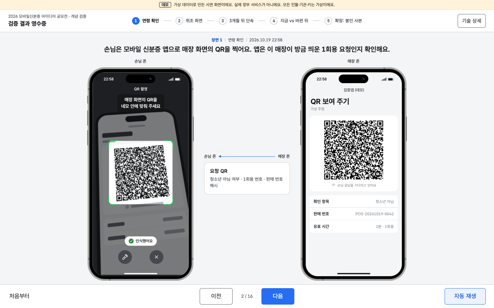 | 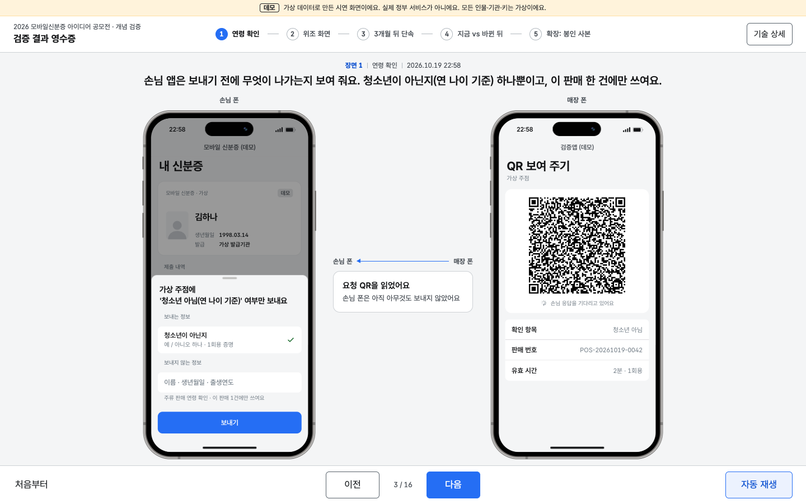 |
| **② 위조 화면 (생년 변조)** | **모바일 폭 카메라 (390×844)** |
| 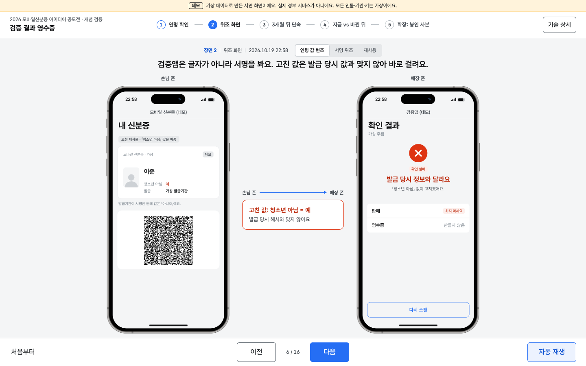 | 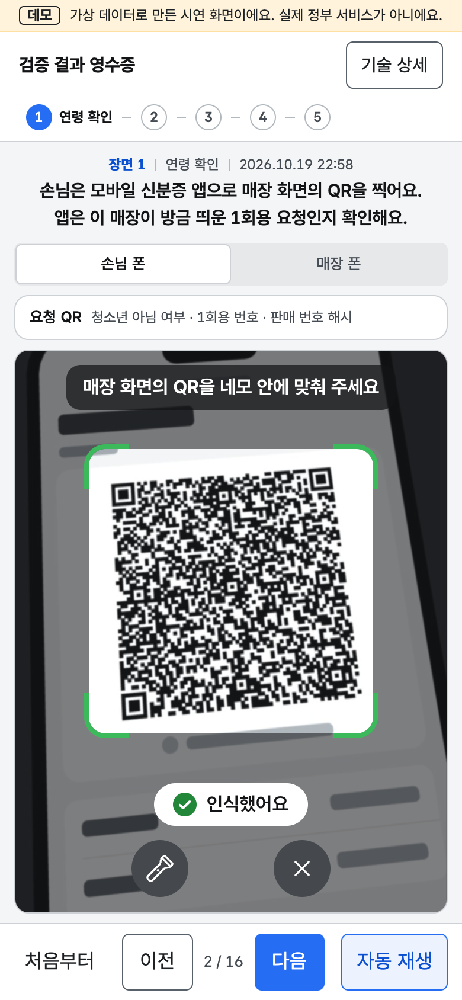 |
| **③ 3개월 뒤 단속: 재검증 항목** | **③ 대비: 업주가 만든 가짜 영수증 거부** |
| 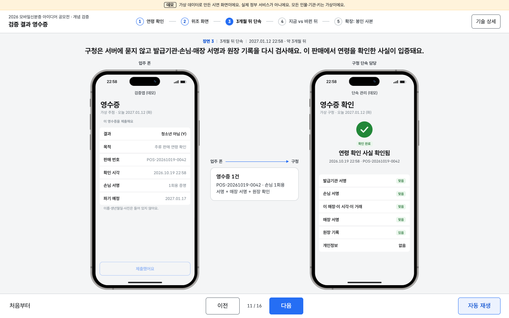 | 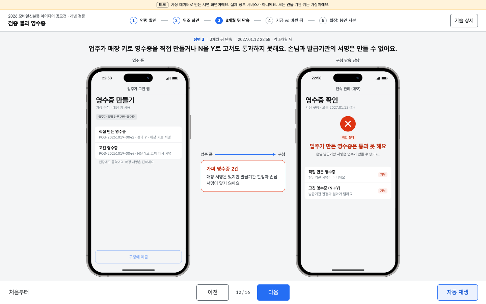 |
| **③ 시작: 지금의 한계 (1280×720)** | **④ 지금 vs 바뀐 뒤** |
| 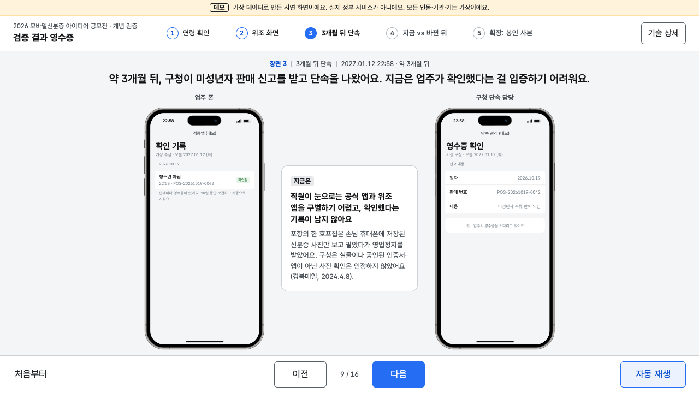 | 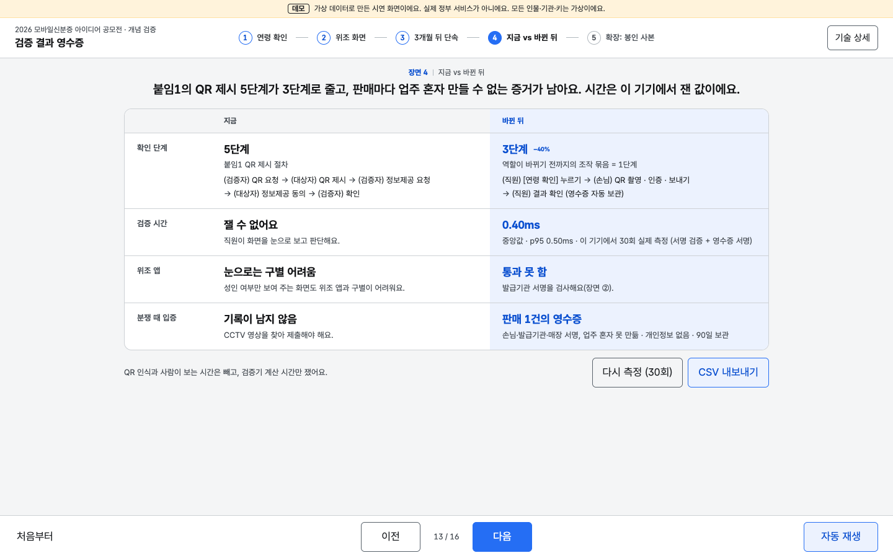 |
| **⑤ 봉인 사본 기한 뒤 (1280×720)** | **모바일 폭 (390×844)** |
| 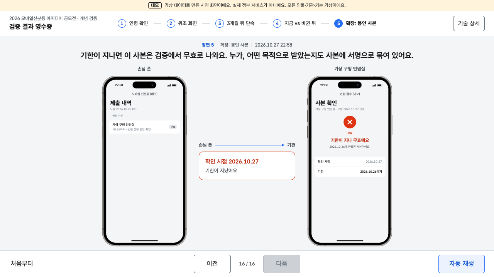 | 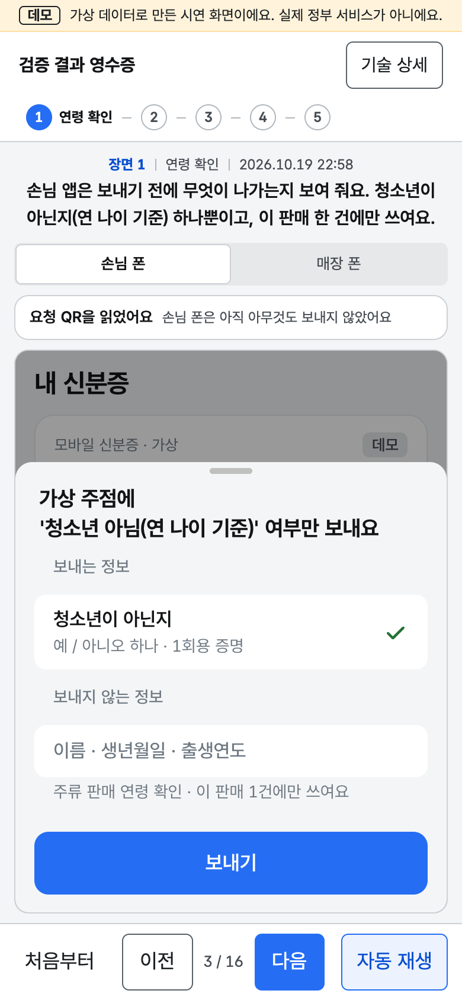 |

`docs/screens/`에는 장면별(① QR 촬영 중·인식(`1-scan`, `1-scan-ok`)·결과·동의 시트, ② 위조 3종, ③ 시작·확인·업주 위조 대비(`3-owner`), ④, ⑤) × 1440×900·1280×720 화면과 모바일 390×844, 1920×1080, [기술 상세 서랍](docs/screens/drawer-1440.png)·[구청 재검증 15단계 서랍](docs/screens/drawer-audit-1440.png)·[QR 촬영 단계 서랍](docs/screens/drawer-scan-1440.png)이 있습니다.

장면 ②(매장 계산대의 손님 공격)와 장면 ③(단속 때 업주 공격)을 나눴습니다. 업주가 만든 가짜 영수증은 판매 순간이 아니라 단속 때 제출되므로, 구청이 진짜 영수증을 확인한 바로 다음 조각에서 같은 화면으로 대비해 보여 줍니다.

### QR 촬영 단계

실제 모바일 신분증 흐름처럼 검증자(매장 검증앱)가 QR을 띄우고 손님 앱이 카메라로 찍습니다.

- 손님 폰 화면은 카메라 뷰파인더입니다. 배경 사진은 `camera.js`가 매장 폰과 같은 요청 글자로 같은 QR(UTF-8, 오류 정정 L)을 그린 뒤, 매장 폰을 원근(호모그래피)·약 5도 회전·흐림을 준 「찍힌 모습」으로 만든 780×1660 이미지입니다.
- 약 2초 뒤 그 이미지의 픽셀을 jsQR 1.4.0으로 실제 디코드하고, 읽은 요청이 매장이 띄운 요청과 모든 필드(nonce·유효시간·매장·항목·목적·거래 데이터)가 같고 유효시간 안일 때만 가이드가 초록으로 바뀌며 다음(동의 시트)으로 넘어갈 수 있습니다. 첫 프레임을 못 읽으면 각도·거리를 조금 바꾼 다음 프레임을 최대 3장까지 읽습니다(실제 카메라도 연속 프레임을 읽음). 영수증 v2 요청은 거래 데이터가 들어가 약 380바이트로 QR이 촘촘해졌고, 한 프레임만 읽을 때 headless Chrome에서 600회 중 2회 실패하던 것이 3프레임에서는 600회 모두 성공했습니다. 끝내 못 읽거나 다르면 가이드 아래에 이유가 나오고 진행이 멈춥니다. 손님 앱은 QR에서 읽은 요청으로 제시물을 만듭니다.
- 스캔 라인은 위아래로 천천히 움직이고, `prefers-reduced-motion`이면 가운데에 멈춰 있습니다. 매장 폰은 그동안 「손님 응답을 기다리고 있어요」 그대로입니다.
- 장면 ②에는 촬영 단계를 따로 넣지 않았습니다. 연령 값을 고친 제시물과 재사용 QR은 진짜 앱으로 찍는 흐름을 거치지 않고 화면을 보여 주는 공격이고, 위조 앱만 매장 요청(nonce)에 맞춰 답합니다(실제 코드도 위조물에 새 요청의 nonce를 넣습니다). 세 유형을 같은 구조로 나란히 보여 주는 장면이라 위조 앱에만 촬영 단계를 넣으면 비교가 흐려지므로, 위조 앱 자막에 「매장 요청에 맞춰」만 덧붙였습니다.

조작:

- [다음] / [이전], 키보드 → / ←
- [자동 재생]: 16조각을 정해진 시간(합계 약 2분 6초)으로 넘어가며 자막이 함께 바뀝니다. [일시정지]하면 그 자리에서 멈추고 [이어서 재생]으로 계속합니다.
- [처음부터]: 키·자격증명·영수증을 모두 새로 만들고 ①로 돌아갑니다.
- 장면 이름(위쪽)을 누르면 그 장면으로 바로 갑니다. 앞 장면 데이터가 없으면 순서대로 실제로 만든 뒤 보여 줍니다.
- 폰 프레임은 화면 높이에 맞춰 자동으로 줄어듭니다(사용 가능한 높이 = 창 높이 − 머리띠·스테퍼·자막·조작 막대). 1280×720부터 1920×1080까지 위아래 베젤까지 다 보이고 조작 막대와 겹치지 않습니다. 폰 안 화면은 항상 390×830(CSS px)으로 그린 뒤 축소하므로 어느 창 크기에서도 배치가 같습니다.
- 폰 안의 버튼([연령 확인], [보내기], [구청에 제출] 등)을 눌러도 다음으로 넘어갑니다.
- 좁은 화면(760px 이하, 휴대폰)에서는 폰 프레임을 숨기고 앱 화면 한 개를 꽉 차게 보여 줍니다. 휴대폰 안에 휴대폰 그림을 넣으면 글자가 절반 크기로 줄어 읽기 어렵기 때문입니다. 「손님 폰 / 매장 폰」 전환으로 바꾸고, 장면이 넘어가면 그 장면에서 일이 일어나는 폰으로 자동 전환됩니다. 가운데 「오간 정보」는 앱 위 한 줄로 나옵니다.
- 주소로 장면 지정: `?scene=3&beat=2`(1부터). `&drawer=1`은 서랍을 연 채로, `?w=390`은 화면 폭을 390px로 강제(배치 확인용)합니다.

## 실행

```bash
cd poc-검증결과영수증
python3 scripts/serve.py 8000      # 또는 python3 -m http.server 8000
# 브라우저에서 http://localhost:8000/
```

- 빌드 도구가 없습니다. 정적 파일(HTML/CSS/ES 모듈)만 있습니다. GitHub Pages에 그대로 올라갑니다.
- WebCrypto는 **localhost 또는 https**에서만 동작합니다. `file://`로 열면 ES 모듈이 막힙니다.
- macOS 기본 Python 3.9의 `http.server`는 대기열이 작아 모듈을 동시에 받을 때 가끔 `ERR_CONNECTION_RESET`이 납니다. `scripts/serve.py`(표준 라이브러리, 대기열 128)를 쓰세요.
- KRDS·Pretendard·devices.css·Ionic·QR 라이브러리(그리기·읽기)는 CDN(jsDelivr·cdnjs, 버전 고정)에서 받으므로 시연할 때 인터넷이 필요합니다. QR 그리기 라이브러리가 없으면 QR 자리에 안내 문구가 나오고, 손님 앱이 QR을 읽지 못하므로 장면 ①의 촬영 단계에서 멈춥니다.

## 테스트

```bash
node --test test/*.test.mjs   # Node 20 이상, 외부 패키지 없음 (내장 webcrypto)
```

모두 57개입니다(2026-10-19 기준 `ℹ tests 57 · pass 57 · fail 0`).

- `test/receipt2.test.mjs` (18개, 영수증 v2): T1 정상 판매 → 85일 뒤 15단계 통과·원장에는 영수증 해시·증명 해시·매장 가명·시각·결과만, T2 업주 자가 발급(제시물 없음), T3 업주 자가 발급(가짜 발급기관), T4 N→Y 재서명, T5 바꿔치기(거래번호 불일치), T6 같은 증명 돌려쓰기(지갑 거부 + `findReuse`·R14 탐지), T7 다른 매장 제시물 끼워 넣기, T8 다른 매장 nonce로 만든 제시물(검증 시점 거부), T9 시각 조작(−3시간), T10 원장 기록 25시간 뒤·다른 영수증의 원장 기록, T11 매장 키 폐기 전후, T12 같은 날 발급된 두 증명도 홀더 키·salt·iat·exp로 연결되지 않음(iat·exp는 같은 주 다른 사람·다른 요일 발급분과 같은 값, 하루 단위 값 없음), T13 연 나이 경계(12월 31일생·1월 1일생·올해 19세가 되는 해·KST 기준), T14 생년월일 공개 항목 혼입, T15 false 증명은 다음 1월 1일 0시 만료(새해 제시 거부, 지난해 N 영수증은 계속 재검증), T16 영수증 nonce 바꿔 재서명, T17 매장 A에서 쓴 증명을 매장 B 영수증에 재사용 → 원장 대조로 거부(먼저 쓴 A는 통과 + 경고, 원장에 개인정보·실제 매장 ID 없음), T18 단속 기관이 기대한 목적과 다른 목적 코드 거부.
- `test/core.test.mjs` (23개): 발급(연 나이, 신분증 자격증명과 연령 증명의 항목, 평문 미포함), 제시(청소년 아님 하나만 공개, 손님 서명에 매장·nonce·거래 해시), 검증과 영수증 v2(Y/N, 개인정보 없음, 같은 사람 영수증 비연결, 다른 매장 거부), 변조(생년 변조, 서명 위조, 재사용 nonce, 다른 검증기 nonce, nonce 만료, 탈취 재서명, 형식 불량), 영수증 위변조·만료(90일, 재서명 없는 변조, 미등록 매장, 개인정보 필드), 봉인 사본, 측정, 단계 수(붙임1 5단계 → 3단계, 40%, 이웃 단계는 역할이 다름, CCTV는 단계 아님).
- `test/scan.test.mjs` (6개): 장면 ①의 촬영 단계 위치와 전체 16조각, 요청의 nonce·유효시간(120초)·거래 데이터(거래번호 평문 없음), 읽은 요청 대조(일치 / 다른 nonce·매장·항목·목적·거래, 형식 불량, 시간 지남은 불일치), 읽은 요청으로 만든 제시물의 검증 통과, 원근 변환 네 모서리.
- `test/scenes.test.mjs` (10개): 장면 진행(다음/이전, 자동 재생 길이 약 2분, 문구 「~요」체, 주소 쿼리), 한국 시각 표기, 그리고 화면이 쓰는 `lib/demo-flow.js`를 그대로 돌려 장면 ①~⑤의 결과(Y + 영수증 + 원장 기록, 위조 3종이 각각 다른 검사에서 거부, 85일 뒤 15단계 통과, 업주 위조 2종 거부, 30회 측정·CSV·단계별 측정 함수, 봉인 사본 기한)를 확인.

스크린샷·콘솔 오류 확인(Chrome DevTools 프로토콜, 외부 패키지 없음, Node 22 이상):

```bash
python3 scripts/serve.py 8799 &
node scripts/shoot.mjs http://localhost:8799/ docs/screens          # 장면 × (1440x900, 1280x720) + 모바일 390x844 + 1920x1080 (--only=1-scan 처럼 일부만)
node scripts/shoot.mjs http://localhost:8799/ docs/screens --play   # 자동 재생을 처음부터 끝까지(약 2분 6초) 돌리며 검사
node scripts/measure.mjs http://localhost:8799/ 30                  # 단계별 소요 시간 → docs/measurements.md
```

다음 중 하나라도 있으면 실패로 끝납니다: 콘솔 오류·경고·예외(폰 iframe 포함), 가로 넘침, 폰 프레임이 자막·조작 막대와 겹침, 폰 안 본문이 넘쳐 스크롤이 필요함, 바텀시트 버튼이 화면 밖, 목록 글자 가로 잘림, 비교표 세로 넘침, 카메라 화면의 안내·가이드·인식 표시·버튼 겹침, QR 촬영 장면의 카메라 상태가 기대(찾는 중 / 인식)와 다름.

## 구조

```
index.html          바깥 화면 (스테퍼, 내레이션, devices.css 폰 프레임 두 대, 조작 막대, 기술 상세 서랍)
app.css             KRDS 토큰만 쓰는 배치. 좁은 화면은 컨테이너 쿼리로 프레임 없이 앱 하나
app.js              진행·자동 재생·서랍, 폰 배율 계산, 폰 iframe과 postMessage. 서명·검증은 하지 않음
screens.js          장면별 폰 화면을 Ionic(iOS) 마크업으로 만듦 (값은 demo-flow 결과)
camera.js           손님 앱 카메라 사진(매장 폰 QR을 기울여 찍은 모습)을 그리고 jsQR로 디코드
phone.html/js/css   폰 한 대 = iframe 하나. Ionic 8 iOS 모드, 상태 표시줄·홈 막대, 받은 화면 그리기
lib/
  demo-flow.js      장면이 쓰는 실제 흐름: 준비(연령 증명 묶음·매장·원장), 연령 확인, 위조 3종, 단속 재검증, 업주 위조 대비, 반복 측정, 봉인 사본
  age.js            연 나이 판정(not_youth), 다음 1월 1일 0시(KST), 그날 0시(KST)
  scan.js           읽은 QR과 매장 요청 대조, 카메라 사진용 원근 변환 (순수 함수)
  scenes.js         장면·내레이션 정의, 진행 함수, 실패 문구, 한국 시각 표기 (순수 함수)
  jose.js           base64url, SHA-256, ES256 JWS (WebCrypto ECDSA P-256)
  demo-keys.js      가상 발급기관·검증앱 등록기관·공통기반 원장 고정 키 (공개된 데모 키)
  sdjwt.js          SD-JWT 형식 직접 구현: 신분증 자격증명, 연령 1회용 증명 묶음 발급, 지갑, 제시(KB-JWT·transaction_data_hashes), 검증
  verifier.js       1회용 nonce 저장소(거래 데이터 보관), 판매에 묶인 요청, 검증 + 영수증 v2 + 원장 기록
  receipt.js        매장 인증서, 보관 기한, 개인정보 패턴
  receipt2.js       영수증 v2 발급, 가상 공통기반 원장(증명 해시·매장 가명), 구청 재검증 15단계, 매장 간 재사용 탐지, 연결성 시험
  tamper.js         위조 시연용 공격 생성기 (손님 쪽 4종, 업주 쪽 5종)
  sealed.js         확장: 목적·기한 봉인 사본
  measure.js        단계 수(붙임1 5단계 → 3단계), 시간 기록, CSV
test/               node --test
scripts/serve.py    대기열을 늘린 로컬 서버
scripts/shoot.mjs   장면별 스크린샷 + 콘솔 오류 확인 (기획서용 docs/screens/proposal-1~3.png 포함)
scripts/measure.mjs 이 기기 단계별 소요 시간 30회 측정 → docs/measurements.md
docs/screens/       README용 스크린샷
```

### 신뢰 구조

```
가상 발급기관 키 ──서명──> 연령 1회용 증명(_sd=[H(not_youth)] + 1회용 홀더 공개키 cnf)
1회용 홀더 키 ──서명──> KB-JWT(aud=매장, nonce, iat, sd_hash, transaction_data_hashes)   → 제시물(VP)
가상 등록기관 키 ──서명──> 매장 인증서(매장 ID, 매장 가명 pid, 매장 공개키)
매장 키 ──서명──> 영수증 v2(결과, 시각, 매장, 목적, 만료, nonce, td, vp 원문) + 헤더에 매장 인증서
가상 공통기반 원장 키 ──서명──> 원장 확인(영수증 해시, 매장 가명, 시각)
```

매장 검증 순서: 형식 → 발급기관 서명 → 유효기간 → 선택공개 해시 → 홀더 키 바인딩(서명·sd_hash) → 수신자 → nonce(발행 여부·미사용·120초) → 제시 시각(±300초) → 판매 거래 결합(transaction_data_hashes) → 요청 항목. 구청 재검증은 위의 15단계입니다.
요청하지 않은 항목이 들어오면 표시·보관하지 않고 버립니다. 실패한 제시물에는 영수증을 발급하지 않습니다.

## 디자인 원칙

- 바깥 페이지는 KRDS(`krds-uiux@1.1.0`) 색·글자 크기·모서리 토큰과 버튼 컴포넌트, 서체 Pretendard GOV.
- 폰 안은 실제 iOS 앱 구조(Ionic `mode="ios"`): 앱 이름 내비게이션 바, 큰 제목, 인셋 목록(`ion-list inset`/`ion-item`/`ion-note`/`ion-badge`), 하단 고정 버튼(`ion-footer`), 높이 자동 바텀시트(`ion-modal`, 끌어 내려도 닫히지 않음), 대기 표시(`ion-spinner`). 색은 KRDS 값과 같은 파랑·초록·빨강, 글꼴은 `--ion-font-family`로 Pretendard GOV.
- 폰 상단 시계는 장면 시각(③은 85일 뒤, ⑤는 다음 날·기한 뒤)이고, 그 날짜는 앱 큰 제목 아래 「오늘 2027.01.12 (화)」처럼 함께 보입니다.
- 그라데이션·반투명 유리 효과·장식 이모지·큰 그림자는 쓰지 않습니다.
- 색은 의미에만: 성공 초록, 실패 빨강, 주 버튼 KRDS 기본 파랑, 나머지 무채색. 성공/실패는 아이콘 모양(체크/엑스)과 「확인 완료」「확인 실패」 글자로도 구분합니다.
- 앱 화면 하나에 메시지 하나: 결과 아이콘·상태 배지·큰 결과 문구·보조 설명 한 줄, 하단 주 버튼 하나.
- 전환은 200ms 페이드, 바텀시트는 Ionic 기본 슬라이드. `prefers-reduced-motion`이면 페이드를 끕니다.
- 정부 로고·상징·실제 앱 이름은 쓰지 않습니다. 맨 위 띠에 「가상 데이터, 실제 정부 서비스 아님」을 항상 표시합니다.

## 실제 시스템과의 차이

- **가상 키**: 발급기관·등록기관 키는 코드에 개인키까지 공개된 데모 키입니다. 실제로는 HSM에 있고 공개키만 배포됩니다.
- **행안부 API 미연동**: 모바일신분증 발급, 검증앱, 등록기관 기능을 모두 브라우저 안에서 흉내 냅니다. 실제 모바일신분증의 데이터 형식·프로토콜(OmniOne Open DID 등)과는 다릅니다.
- **한 화면 안의 두 폰**: 두 폰은 같은 페이지의 iframe 두 개이고, 서명·검증은 바깥 페이지에서 실행한 결과를 화면으로만 보냅니다. QR은 실제 요청·제시물 내용으로 그립니다. 손님 앱의 QR 촬영은 실제 카메라가 아니라, 같은 QR을 기울이고 흐리게 **합성한 촬영 이미지**에서 jsQR로 실제 디코드합니다(디코드와 요청 대조는 실제로 실행).
- **SD-JWT 형식을 직접 구현(표준 라이브러리 미사용, 데모용)**: RFC 9901 SD-JWT의 구조(salt 공개값, `_sd`, `cnf`, KB-JWT, `sd_hash`)와 OpenID4VP 1.0의 `transaction_data`/`transaction_data_hashes`를 WebCrypto(ES256)로 직접 짠 코드입니다. 디코이 해시, 배열 요소 공개, 상태 목록(폐지 확인), OpenID4VCI 발급·OpenID4VP 응답 전송·응답 암호화(`direct_post.jwt`)는 생략했고 표준 적합성 시험은 하지 않았습니다.
- **연령 항목**: `not_youth`는 발급기관이 발급 시점에 연 나이로 판정합니다. `false` 증명은 다음 1월 1일 0시에 만료되므로 해가 바뀐 뒤 잘못 판정되는 일이 없습니다. 증명 묶음 재충전(온라인)은 데모에서 지갑이 바닥나면 바로 새로 발급하는 것으로 흉내 냅니다.
- **공통기반 원장(로컬 모의)**: 「검증 사실 원장」은 브라우저 메모리 안의 객체입니다. 영수증 해시·증명 해시(발급기관 서명값의 해시, 손님 정보 아님)·매장 가명(등록기관이 인증서에 넣은 `pid`)·시각·결과만 기록하고 서명한 확인을 돌려줍니다. 단속 때 증명 해시를 대조해 매장 간 재사용을 거부합니다(R14). 매장 폐기 목록도 원장 객체의 공개 목록으로 흉내 냅니다. 실제 서버, 시각 동기화, 원장 열람 권한은 없습니다.
- **막지 못하는 것**: 성인의 휴대폰을 빌려 본인 인증까지 하는 경우, 업주·직원·동행한 성인이 같은 판매 요청을 대신 촬영하는 공모(영수증은 '서명이 확인된 성인 증명이 이 판매에 제시됐다'까지만 증명하고 구매자 본인임은 증명하지 않음. 판매 시각으로 CCTV 해당 장면을 바로 찾을 수 있음). 발급기관과 매장이 공모해 영수증 원문을 맞춰 보는 경우의 연결(RFC 9901 §10.1의 구조적 한계).
- **응답 전송·암호화**: 손님 폰에서 매장 폰으로 제시물이 가는 경로(중계 서버·BLE 등)와 매장 키로의 응답 암호화(OpenID4VP `direct_post.jwt`)는 구현하지 않았습니다. 같은 페이지 안에서 값을 넘깁니다.
- **저장소**: 데이터는 메모리에만 있고, 새로고침하거나 [처음부터]를 누르면 새로 만듭니다. 실제 영수증 보관·90일 파기·통계 집계는 검증앱 저장소나 서버의 일입니다.
- **시점 이동**: ③ 단속(85일 뒤)과 ⑤ 기한 뒤 검증은 검증 함수에 미래 시각을 넣어 계산합니다.
- **영수증 발급 위치**: 공모전 조건(민간앱 연계·활용 제한)에 맞춰 영수증은 행안부 검증앱 안에서만 발급된다는 전제입니다.

## 측정 방법

- 검증기의 `verifyPresentation`이 단계마다 `performance.now()` 차이를 기록합니다: 형식 해석, 발급기관 서명, 선택공개 해시, 홀더 서명, nonce·시각, 영수증 서명(`issueReceiptV2`), 합계. 거래 결합 검사는 합계에 들어가고, 원장 기록(실제로는 네트워크 호출)은 재지 않습니다.
- 장면 ④에 들어가면 요청 생성 → 제시물 생성 → 검증+영수증을 30회 반복하고 검증기 쪽 시간만 기록합니다. [다시 측정]으로 다시 잽니다.
- [CSV 내보내기] 열: `time, scenario, outcome, failed_check, parse_ms, issuer_sig_ms, disclosure_ms, holder_binding_ms, nonce_ms, receipt_ms, total_ms, user_agent` (엑셀용 BOM 포함). 장면 ①·②의 기록도 함께 들어갑니다.
- 포함하지 않는 것(장면 ④): QR 인식 시간, 사람이 화면을 보는 시간, 기존 방식(육안 확인·CCTV 검색)의 실제 소요 시간. 기존 방식은 단계 수로만 비교합니다(붙임1 5단계 → 3단계, 40%).
- **단계별 기기 측정**: `node scripts/measure.mjs http://localhost:8799/ 30`이 헤드리스 Chrome에서 `measureStages`(QR 디코드, 발급기관 서명 검증, 매장 검증 전체, 영수증 서명, 구청 재검증 15단계)를 30회 재서 [`docs/measurements.md`](docs/measurements.md)에 표로 씁니다. 데스크톱(감속 없음)과 모바일 에뮬레이션(CPU 4배 감속) 두 번. **실제 휴대폰 측정이 아닙니다.**
- 2026-10-19 데스크톱 Chrome 155(Apple M2) 중앙값: QR 디코드 40.0 ms, 발급기관 서명 검증 0.1 ms, 매장 검증 전체 0.3 ms, 영수증 서명 0.1 ms, 구청 재검증 15단계 2.6 ms. CPU 4배 감속: 154.9 / 0.5 / 1.5 / 0.7 / 11.2 ms.

## 시연 대본 (2분 영상)

준비: 노트북 브라우저를 1440×900 정도로 열고 `http://localhost:8000/` 접속. 화면 녹화를 켜고 [자동 재생]을 누르면 아래 순서로 넘어갑니다(장면 길이는 `lib/scenes.js`의 `ms`). 말로 덧붙일 때는 [일시정지]를 쓰세요.

| 시간 | 장면 | 화면 | 내레이션(자막과 같은 취지) |
|---|---|---|---|
| 0:00–0:07 | ① 연령 확인 | 매장 폰 [연령 확인] | "손님이 술을 주문했어요. 직원은 신분증 화면을 눈으로 보는 대신 검증앱에서 연령 확인을 눌러요. 요청에는 이 판매 번호가 묶여요." |
| 0:07–0:13 | ① | 매장 폰 QR, 손님 앱 카메라 → 가이드 초록 "인식했어요" | "손님은 모바일 신분증 앱으로 매장 화면의 QR을 찍어요. 앱은 이 매장이 방금 띄운 1회용 요청인지 확인해요." |
| 0:13–0:21 | ① | 손님 폰 동의 시트 (매장 폰은 응답 대기) | "보내기 전에 무엇이 나가는지 보여 줘요. 청소년이 아닌지(연 나이 기준) 하나뿐이고, 이 판매 한 건에만 쓰여요." |
| 0:21–0:30 | ① | 매장 폰 초록 결과, 손님 제출 내역 | "매장 폰에는 결과만 떠요. 손님 앱의 1회용 서명이 담긴 영수증이 저장되고 원장에 기록돼요." |
| 0:30–0:37 | ② 위조 화면 | 「청소년 아님」 값을 고친 제시물 | "미성년자가 제시물의 「청소년 아님」 값을 「예」로 고쳐 왔어요. 화면만 봐서는 구별하기 어려워요." |
| 0:37–1:02 | ② | 연령 값 변조 → 서명 위조 → 재사용, 매장 폰 빨간 화면 | "검증앱은 글자가 아니라 서명을 봐요. 매장 요청에 맞춰 서명한 위조 앱도, 이미 쓴 QR도 통과하지 못해요." |
| 1:02–1:10 | ③ 3개월 뒤 단속 | 업주 확인 기록, 구청 화면, 「지금은」 카드 | "약 3개월 뒤 구청이 단속을 나왔어요. 지금은 직원이 눈으로 공식 앱과 위조 앱을 구별하기 어렵고, 확인했다는 기록도 남지 않아요." |
| 1:10–1:26 | ③ | 신고된 판매 번호의 영수증 제출 → 재검증 항목 6줄 "맞음" | "구청은 서버에 묻지 않고 발급기관·손님·매장 서명과 원장 기록을 다시 검사해요." |
| 1:26–1:35 | ③ 대비 | 업주가 만든 가짜 영수증 2건 → "거부" | "업주가 매장 키로 영수증을 직접 만들거나 N을 Y로 고쳐도 통과하지 못해요." |
| 1:35–1:48 | ④ 지금 vs 바뀐 뒤 | 비교표, 측정값 | "붙임1의 QR 제시 5단계가 3단계로 줄고, 판매마다 업주 혼자 만들 수 없는 증거가 남아요. 시간은 이 기기에서 잰 값이에요." |
| 1:48–2:06 | ⑤ 확장: 봉인 사본 | 기관 제출 → 확인 → 기한 뒤 무효 | "같은 구조로 공공기관 제출 사본도 만들어요. 기한이 지나면 무효가 돼요." |

심사위원이 직접 볼 때는 [다음]으로 한 장면씩 넘기고, 궁금한 장면에서 [기술 상세]를 열어 실제 서명·해시·검사 결과를 확인하면 됩니다.

## 사용한 외부 자원과 라이선스

| 자원 | 버전·주소 | 라이선스 |
|---|---|---|
| KRDS HTML 컴포넌트 (대한민국 디지털 정부 디자인 시스템, NIA 배포) | `krds-uiux@1.1.0`, jsDelivr | npm 표기 ISC, 이용 조건은 [KRDS 저작권 정책](https://www.krds.go.kr/html/site/utility/utility_06.html)을 따름 |
| Pretendard GOV | `orioncactus/pretendard@v1.3.9`, jsDelivr | SIL Open Font License 1.1 |
| qrcode-generator | `1.4.4`, cdnjs | MIT |
| jsQR (cozmo/jsQR, 손님 앱의 QR 읽기) | `jsqr@1.4.0`, jsDelivr | Apache-2.0 |
| devices.css (picturepan2/devices.css, 폰 프레임 iPhone 14 Pro) | `devices.css@0.2.0`, jsDelivr | MIT |
| Ionic Core (ionic-team/ionic-framework, 폰 안 iOS 앱 컴포넌트) | `@ionic/core@8.4.0`, jsDelivr | MIT |

KRDS를 쓴 이유: 공공 서비스 공모전이므로 범정부 표준 디자인 시스템의 토큰과 버튼 컴포넌트를 따랐습니다. 이 화면은 정부 누리집이 아니므로 KRDS의 「공식 전자정부 누리집」 표시(masthead)와 정부 상징은 쓰지 않았습니다.

이 저장소의 코드는 MIT 라이선스입니다.

## 생성형 AI 사용

코드(서명·검증 로직, 화면, 테스트, 스크립트) 작성에 생성형 AI(Anthropic Claude)를 사용했습니다. 설계 결정(영수증 v2 구조, 연 나이 기준, 장면 구성)과 코드 검수, 테스트·스크린샷 결과 확인은 제안자가 했습니다.
