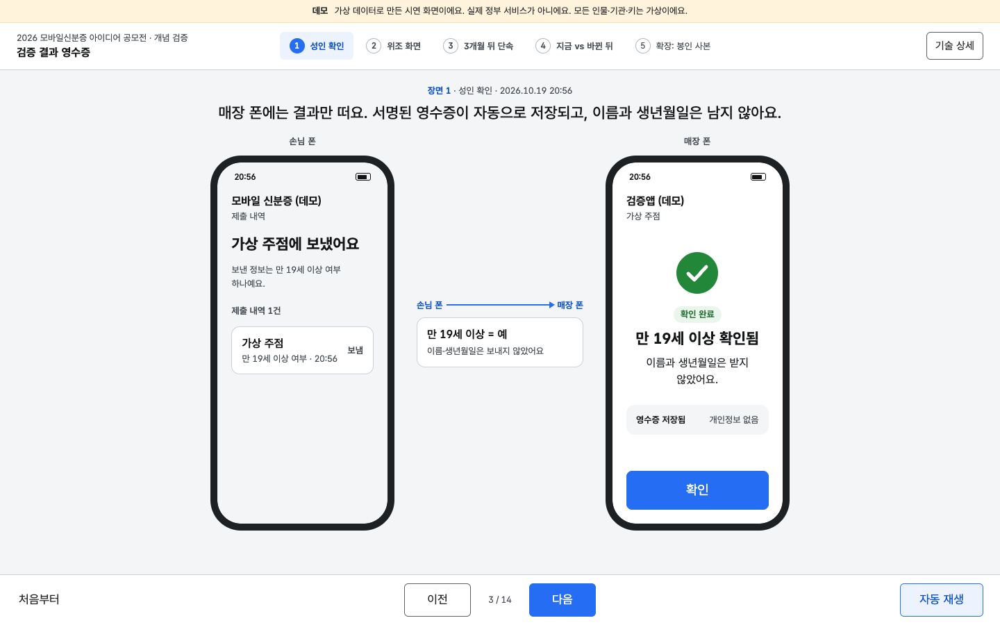
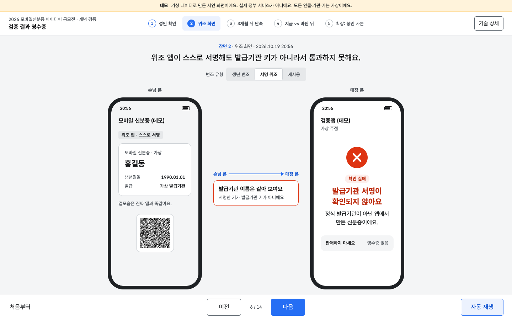
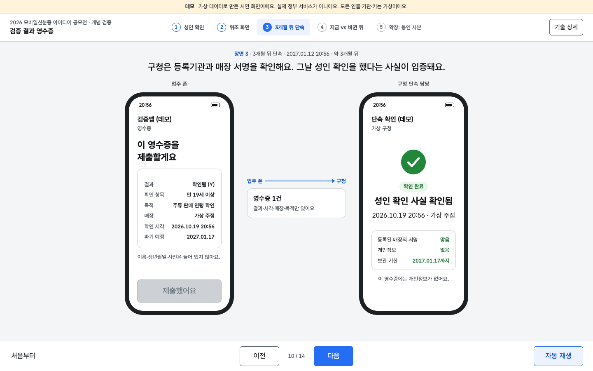
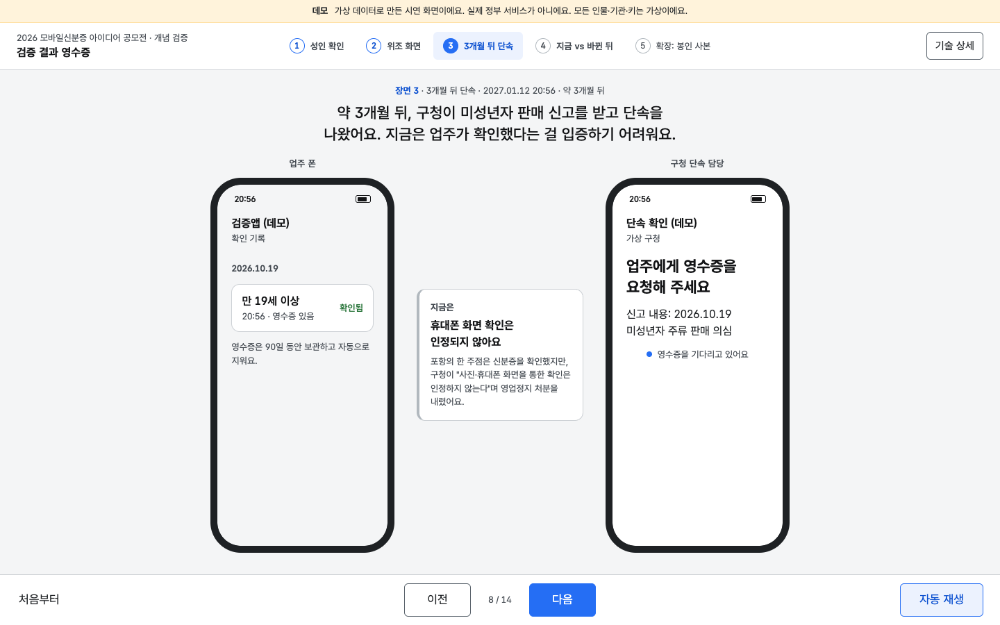
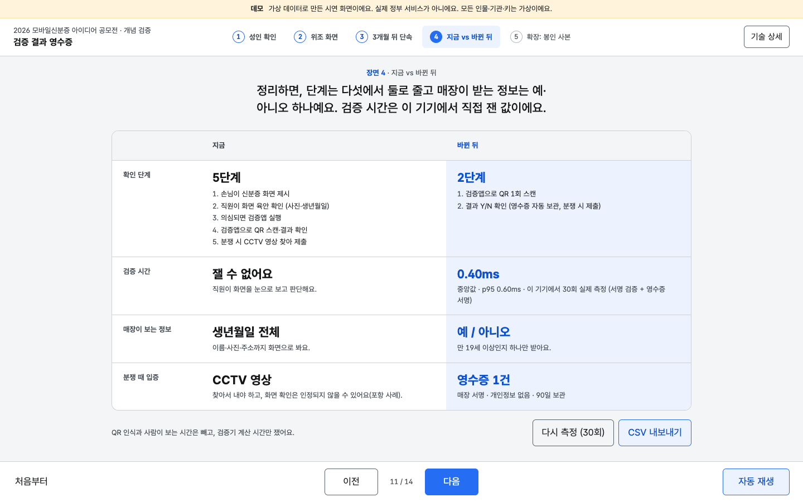
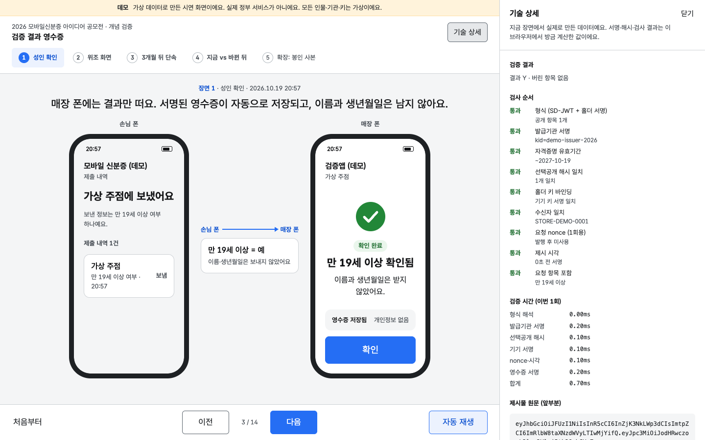
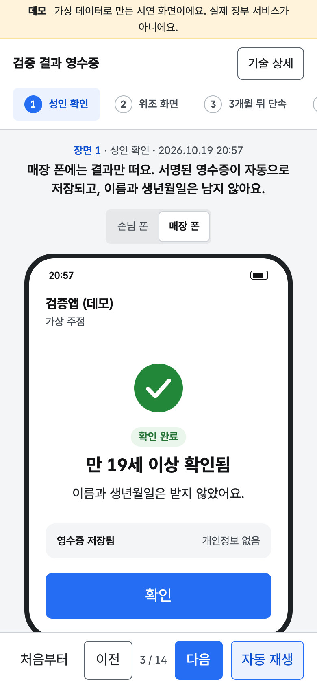

# 검증 결과 영수증 PoC

2026 모바일신분증 아이디어 공모전 제출용 개념 검증(PoC)입니다.
**가상 데이터·데모용**이며 실제 행안부 시스템과 연결되어 있지 않습니다.



## 목적

매장·기관은 신분증 화면이나 사진을 보는 대신, **발급기관 서명으로 검증된 결과**(예: 만 19세 이상 Y/N)만 받습니다.
검증할 때마다 매장 키로 서명한 **영수증**을 보관하며, 영수증에는 개인정보가 없습니다.

| 영수증 필드 | 내용 |
|---|---|
| `result` | Y / N |
| `claim`, `purpose` | 확인 항목(`age_over_19`), 목적(주류 판매 연령 확인) |
| `store` | 매장 ID (헤더의 매장 인증서 `scert`로 등록기관 서명과 연결) |
| `iat`, `exp` | 검증 시각, 파기 예정(90일) |
| `vp_hash` | 제시물 SHA-256. 제시물마다 nonce가 새로 들어가므로 같은 사람의 영수증끼리 연결되지 않음 |
| `ver`, `rid` | 형식 버전, 무작위 영수증 번호 |

이름, 생년월일, 주민등록번호, 사진, 지갑 키는 들어가지 않습니다. 허용 목록 밖의 필드가 있거나 값이 생년월일·주민등록번호·전화번호 형태이면 분쟁 검증에서 실패로 처리합니다.

## 화면: 두 대의 폰과 다섯 장면

왼쪽은 **손님 폰**(모바일 신분증 앱), 오른쪽은 **매장 폰**(검증앱)입니다. 가운데에는 두 폰 사이에 실제로 오간 정보가 표시되고, 위에는 한 줄 내레이션이 나옵니다.
[다음] 하나로 진행하거나 [자동 재생]으로 약 2분 동안 저절로 넘어갑니다. 모든 결과는 화면용 연출이 아니라 `lib/`의 서명·검증 코드를 브라우저에서 그때그때 실행한 값입니다.

| 장면 | 보이는 것 | 실제로 실행되는 것 |
|---|---|---|
| ① 성인 확인 | 매장 [성인 확인] → QR → 손님 폰 동의 시트("'만 19세 이상' 여부만 보내요") → 매장 폰 "만 19세 이상 확인됨 · 영수증 저장됨" → 손님 폰 제출 내역 | 1회용 요청 발행, `age_over_19`만 공개한 제시물 + 기기 서명, 9단계 검증, 매장 서명 영수증 발급 |
| ② 위조 화면 | 생년월일을 고친 캡처 / 위조 앱 / 남이 쓴 QR → 매장 폰 빨간 실패 화면과 이유 한 줄. 위쪽 토글로 유형 선택 | `tamperBirth`(해시 불일치), `forgeWithFakeIssuer`(발급기관 서명 불일치), ①의 제시물 재제출(nonce 재사용). 영수증 없음 |
| ③ 3개월 뒤 단속 | 왼쪽은 업주 폰(확인 기록·영수증), 오른쪽은 구청 단속 담당. 가운데 "지금은: 휴대폰 화면 확인은 인정되지 않아요(포항 사례)" → 영수증 제출 → "성인 확인 사실 확인됨" | ①의 영수증을 85일 뒤 시점으로 `verifyReceipt` (등록기관 인증서·매장 서명·필드·보관 기한) |
| ④ 지금 vs 바뀐 뒤 | 단계 5→2, 검증 시간, 매장이 보는 정보(생년월일 전체 vs 예·아니오), 분쟁 입증(CCTV vs 영수증). [다시 측정] [CSV 내보내기] | 정상 검증 30회 반복 측정(`measure.js`), 중앙값·p95 |
| ⑤ 확장: 봉인 사본 | 손님이 기관에 사본 제출(목적·기한) → 기한 안 "본인 확인됨" → 기한 뒤 "기한이 지나 무효예요" | `createSealedCopy` / `verifySealedCopy`를 다음 날·기한 하루 뒤 시점으로 검증 |

**기술 상세** 서랍(오른쪽 위 버튼)을 열면 지금 장면의 실제 데이터가 나옵니다: 제시물 원문 앞부분, 공개된 항목과 salt, 발급기관 서명 본문, KB-JWT(aud·nonce·sd_hash), 검사 9단계 통과/실패, 단계별 ms, 영수증 JWS 헤더·본문 전체 필드. 기본은 닫혀 있습니다.

| ② 위조 화면 | ③ 3개월 뒤 단속 |
|---|---|
|  |  |
| **③ 시작: 지금은 화면 확인이 인정되지 않음** | **④ 지금 vs 바뀐 뒤** |
|  |  |
| **기술 상세 서랍** | **모바일 폭 (390px)** |
|  |  |

그 밖의 화면: [① 동의 시트](docs/screens/1-consent.png), [⑤ 봉인 사본 기한 뒤](docs/screens/5-sealed.png), [모바일 동의 시트](docs/screens/mobile-consent.png).

조작:

- [다음] / [이전], 키보드 → / ←
- [자동 재생]: 장면마다 정해진 시간(합계 약 2분)으로 넘어가며 자막이 함께 바뀝니다. [일시정지]하면 그 자리에서 멈추고 [이어서 재생]으로 계속합니다.
- [처음부터]: 키·자격증명·영수증을 모두 새로 만들고 ①로 돌아갑니다.
- 장면 이름(위쪽)을 누르면 그 장면으로 바로 갑니다. 앞 장면 데이터가 없으면 순서대로 실제로 만든 뒤 보여 줍니다.
- 좁은 화면(760px 이하)에서는 폰 한 대만 보이고, 「손님 폰 / 매장 폰」 전환으로 바꿉니다. 장면이 넘어가면 그 장면에서 일이 일어나는 폰으로 자동 전환됩니다.
- 주소로 장면 지정: `?scene=3&beat=2`(1부터). `&drawer=1`은 서랍을 연 채로, `?w=390`은 화면 폭을 390px로 강제(배치 확인용)합니다.

## 실행

```bash
cd poc-검증결과영수증
python3 scripts/serve.py 8000      # 또는 python3 -m http.server 8000
# 브라우저에서 http://localhost:8000/
```

- 빌드 도구가 없습니다. 정적 파일(HTML/CSS/ES 모듈)만 있습니다. GitHub Pages에 그대로 올라갑니다.
- WebCrypto는 **localhost 또는 https**에서만 동작합니다. `file://`로 열면 ES 모듈이 막힙니다.
- macOS 기본 Python 3.9의 `http.server`는 대기열이 작아 모듈을 동시에 받을 때 가끔 `ERR_CONNECTION_RESET`이 납니다. `scripts/serve.py`(표준 라이브러리, 대기열 128)를 쓰세요.
- QR 그리기 라이브러리는 CDN에서 받습니다. 오프라인이면 QR 자리에 안내 문구가 나오고 나머지 흐름은 그대로 동작합니다.

## 테스트

```bash
node --test test/*.test.mjs   # Node 20 이상, 외부 패키지 없음 (내장 webcrypto)
```

- `test/core.test.mjs` (22개): 발급(만 나이, salt 해시, 평문 미포함), 제시(만 19세 이상 하나만 공개), 검증과 영수증(Y/N, 개인정보 없음, 비연결성, 다른 매장 거부), 변조(생년 변조, 서명 위조, 재사용 nonce, 다른 검증기 nonce, nonce 만료, 탈취 재서명, 형식 불량), 영수증 위변조·만료, 봉인 사본, 측정.
- `test/scenes.test.mjs` (9개): 장면 진행(다음/이전, 자동 재생 길이 약 2분, 문구 「~요」체, 주소 쿼리), 한국 시각 표기, 그리고 화면이 쓰는 `lib/demo-flow.js`를 그대로 돌려 장면 ①~⑤의 결과(Y + 영수증, 위조 3종이 각각 다른 검사에서 거부, 85일 뒤 영수증 검증, 30회 측정·CSV, 봉인 사본 기한)를 확인.

스크린샷·콘솔 오류 확인(Chrome DevTools 프로토콜, 외부 패키지 없음, Node 22 이상):

```bash
python3 scripts/serve.py 8799 &
node scripts/shoot.mjs http://localhost:8799/ docs/screens   # 데스크톱 1440x900, 모바일은 390x844 기기 에뮬레이션
```

장면별 화면을 `docs/screens/`에 저장하고, 콘솔 오류·예외·가로 넘침이 있으면 실패로 끝납니다.

## 구조

```
index.html          화면 뼈대 (두 대의 폰, 내레이션, 조작 막대, 기술 상세 서랍)
app.css             KRDS 토큰만 쓰는 배치. 좁은 화면은 컨테이너 쿼리로 폰 한 대씩
app.js              장면 그리기·자동 재생·서랍. 서명·검증은 하지 않음
lib/
  demo-flow.js      장면이 쓰는 실제 흐름: 준비, 성인 확인, 위조 3종, 단속 검증, 반복 측정, 봉인 사본
  scenes.js         장면·내레이션 정의, 진행 함수, 실패 문구, 한국 시각 표기 (순수 함수)
  jose.js           base64url, SHA-256, ES256 JWS (WebCrypto ECDSA P-256)
  demo-keys.js      가상 발급기관·가상 검증앱 등록기관 고정 키 (공개된 데모 키)
  sdjwt.js          SD-JWT 유사 자격증명 발급·제시(KB-JWT)·검증
  verifier.js       1회용 nonce 저장소, 검증 요청, 검증+영수증 발급
  receipt.js        매장 인증서, 영수증 발급·검증(형식·서명·필드·90일)
  tamper.js         위조 시연용 공격 생성기
  sealed.js         확장: 목적·기한 봉인 사본
  measure.js        단계 수, 시간 기록, CSV
test/               node --test
scripts/serve.py    대기열을 늘린 로컬 서버
scripts/shoot.mjs   장면별 스크린샷 + 콘솔 오류 확인
docs/screens/       README용 스크린샷
```

### 신뢰 구조

```
가상 발급기관 키 ──서명──> 자격증명(_sd 해시 목록 + 지갑 공개키 cnf)
지갑 키 ──서명──> KB-JWT(aud=매장, nonce, sd_hash)          → 제시물(VP)
가상 등록기관 키 ──서명──> 매장 인증서(매장 ID, 매장 공개키)
매장 키 ──서명──> 영수증(결과, 시각, 매장, 목적, 만료, vp_hash) + 헤더에 매장 인증서
```

검증기 검사 순서: 형식 → 발급기관 서명 → 유효기간 → 선택공개 해시 → 홀더 키 바인딩(서명·sd_hash) → 수신자 → nonce(발행 여부·미사용·120초) → 제시 시각(±300초) → 요청 항목.
요청하지 않은 항목이 들어오면 표시·보관하지 않고 버립니다. 실패한 제시물에는 영수증을 발급하지 않습니다.

## 디자인 원칙

- KRDS(`krds-uiux@1.1.0`) 색·글자 크기·모서리 토큰과 버튼 컴포넌트, 서체 Pretendard GOV.
- 색은 의미에만: 성공 초록, 실패 빨강, 주 버튼 KRDS 기본 파랑, 나머지 무채색. 성공/실패는 아이콘 모양(체크/엑스)과 「확인 완료」「확인 실패」 글자로도 구분합니다.
- 앱 화면 하나에 메시지 하나: 큰 결과 문구, 보조 설명 한 줄, 하단 주 버튼 하나. 글자 크기는 3단계(22/16/13px).
- 전환은 200ms 페이드, 바텀시트만 220ms 슬라이드. `prefers-reduced-motion`이면 끕니다.
- 정부 로고·상징·실제 앱 이름은 쓰지 않습니다. 맨 위 띠에 「가상 데이터, 실제 정부 서비스 아님」을 항상 표시합니다.

## 실제 시스템과의 차이

- **가상 키**: 발급기관·등록기관 키는 코드에 개인키까지 공개된 데모 키입니다. 실제로는 HSM에 있고 공개키만 배포됩니다.
- **행안부 API 미연동**: 모바일신분증 발급, 검증앱, 등록기관 기능을 모두 브라우저 안에서 흉내 냅니다. 실제 모바일신분증의 데이터 형식·프로토콜(OmniOne Open DID 등)과는 다릅니다.
- **한 화면 안의 두 폰**: 두 폰은 같은 페이지 안에서 데이터를 주고받습니다. QR은 실제 요청·제시물 내용으로 그리지만, 카메라로 읽는 단계는 생략했습니다.
- **SD-JWT 단순화**: IETF SD-JWT VC 구조(salt 공개값, `_sd`, `cnf`, KB-JWT, `sd_hash`)를 따르되 디코이 해시, 배열 요소 공개, 상태 목록(폐지 확인)은 생략했습니다.
- **연령 항목**: `age_over_19`는 발급 시점 값입니다. 실제로는 짧은 유효기간 재발급이나 검증 시점 계산이 필요합니다.
- **저장소**: 데이터는 메모리에만 있고, 새로고침하거나 [처음부터]를 누르면 새로 만듭니다. 실제 영수증 보관·90일 파기·통계 집계는 검증앱 저장소나 서버의 일입니다.
- **시점 이동**: ③ 단속(85일 뒤)과 ⑤ 기한 뒤 검증은 검증 함수에 미래 시각을 넣어 계산합니다.
- **영수증 발급 위치**: 공모전 조건(민간앱 연계·활용 제한)에 맞춰 영수증은 행안부 검증앱 안에서만 발급된다는 전제입니다.

## 측정 방법

- 검증기의 `verifyPresentation`이 단계마다 `performance.now()` 차이를 기록합니다: 형식 해석, 발급기관 서명, 선택공개 해시, 홀더 서명, nonce·시각, 영수증 서명(`issueReceipt`), 합계.
- 장면 ④에 들어가면 요청 생성 → 제시물 생성 → 검증+영수증을 30회 반복하고 검증기 쪽 시간만 기록합니다. [다시 측정]으로 다시 잽니다.
- [CSV 내보내기] 열: `time, scenario, outcome, failed_check, parse_ms, issuer_sig_ms, disclosure_ms, holder_binding_ms, nonce_ms, receipt_ms, total_ms, user_agent` (엑셀용 BOM 포함). 장면 ①·②의 기록도 함께 들어갑니다.
- 포함하지 않는 것: QR 인식 시간, 사람이 화면을 보는 시간, 기존 방식(육안 확인·CCTV 검색)의 실제 소요 시간. 기존 방식은 단계 수로만 비교합니다(5단계 → 2단계).
- 참고 측정(2026-10-19, macOS, headless Chrome): 30회, 영수증 서명 포함 합계 중앙값 0.40 ms, p95 0.50 ms. 실제 시연 기기(휴대폰)에서 다시 재서 제출하세요.

## 시연 대본 (2분 영상)

준비: 노트북 브라우저를 1440×900 정도로 열고 `http://localhost:8000/` 접속. 화면 녹화를 켜고 [자동 재생]을 누르면 아래 순서로 넘어갑니다(장면 길이는 `lib/scenes.js`의 `ms`). 말로 덧붙일 때는 [일시정지]를 쓰세요.

| 시간 | 장면 | 화면 | 내레이션(자막과 같은 취지) |
|---|---|---|---|
| 0:00–0:07 | ① 성인 확인 | 매장 폰 [성인 확인] | "손님이 술을 주문했어요. 직원은 신분증 화면을 눈으로 보는 대신 검증앱에서 성인 확인을 눌러요." |
| 0:07–0:16 | ① | 매장 QR, 손님 폰 동의 시트 | "손님 앱은 보내기 전에 무엇이 나가는지 보여 줘요. 만 19세 이상인지 하나뿐이에요." |
| 0:16–0:26 | ① | 매장 폰 초록 결과, 손님 제출 내역 | "매장 폰에는 결과만 떠요. 서명된 영수증이 자동으로 저장되고, 이름과 생년월일은 남지 않아요." |
| 0:26–0:34 | ② 위조 화면 | 생년월일을 고친 캡처 화면 | "미성년자가 친구 화면을 캡처해 생년월일을 고쳐 왔어요. 눈으로는 구별하기 어려워요." |
| 0:34–0:59 | ② | 생년 변조 → 서명 위조 → 재사용, 매장 폰 빨간 화면 | "검증앱은 글자가 아니라 서명을 봐요. 위조 앱도, 이미 쓴 QR도 통과하지 못해요." |
| 0:59–1:08 | ③ 3개월 뒤 단속 | 업주 확인 기록, 구청 화면, 포항 사례 카드 | "약 3개월 뒤 구청이 단속을 나왔어요. 지금은 휴대폰 화면 확인이 인정되지 않아 영업정지까지 받아요." |
| 1:08–1:25 | ③ | 영수증 제출 → "성인 확인 사실 확인됨" | "업주는 그날의 영수증을 내요. 구청은 서명을 확인하고, 영수증에는 개인정보가 없어요." |
| 1:25–1:41 | ④ 지금 vs 바뀐 뒤 | 비교표, 측정값 | "단계는 다섯에서 둘로, 매장이 받는 정보는 예·아니오 하나로 줄어요. 검증은 1밀리초 안팎이에요." |
| 1:41–2:00 | ⑤ 확장: 봉인 사본 | 기관 제출 → 확인 → 기한 뒤 무효 | "같은 구조로 공공기관 제출 사본도 만들어요. 기한이 지나면 무효라 사진처럼 남지 않아요." |

심사위원이 직접 볼 때는 [다음]으로 한 장면씩 넘기고, 궁금한 장면에서 [기술 상세]를 열어 실제 서명·해시·검사 결과를 확인하면 됩니다.

## 사용한 외부 자원과 라이선스

| 자원 | 버전·주소 | 라이선스 |
|---|---|---|
| KRDS HTML 컴포넌트 (대한민국 디지털 정부 디자인 시스템, NIA 배포) | `krds-uiux@1.1.0`, jsDelivr | npm 표기 ISC, 이용 조건은 [KRDS 저작권 정책](https://www.krds.go.kr/html/site/utility/utility_06.html)을 따름 |
| Pretendard GOV | `orioncactus/pretendard@v1.3.9`, jsDelivr | SIL Open Font License 1.1 |
| qrcode-generator | `1.4.4`, cdnjs | MIT |

KRDS를 쓴 이유: 공공 서비스 공모전이므로 범정부 표준 디자인 시스템의 토큰과 버튼 컴포넌트를 따랐습니다. 이 화면은 정부 누리집이 아니므로 KRDS의 「공식 전자정부 누리집」 표시(masthead)와 정부 상징은 쓰지 않았습니다.

이 저장소의 코드는 MIT 라이선스입니다.
